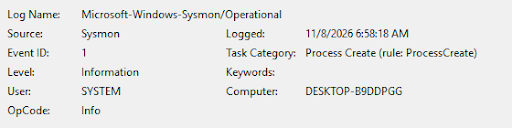
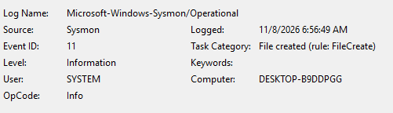
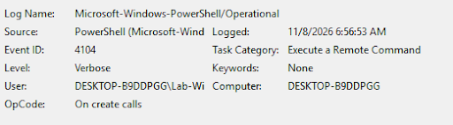

# Atomic Red Team Lab — Troubleshooting Log

## Overview

**Environment:** A Windows 11 Home laptop (16 GB RAM, Intel x64) running **VirtualBox 7.2**, with a Windows 11 x64 guest VM (`ART-Lab-Win11`: 6 GB RAM, 2 vCPUs, 60 GB disk, EFI + TPM 2.0 + Secure Boot). Sysmon and PowerShell logging are enabled inside the VM. The VM stays on an Internal Network while tests run.
**Goal:** Build an isolated lab to practice detection testing with Atomic Red Team (Red Canary), and check whether Sysmon and PowerShell logs capture evidence of each technique.

> This lab is for learning on my own machine only. Never run these tests on a physical host or on any organization's systems without written authorization.

**Lab rules I follow:** run Atomic Red Team inside the VM only, take a snapshot before every risky step, treat the VM as disposable (revert instead of repair), disable shared folders / clipboard / drag-and-drop, exclude only `C:\AtomicRedTeam` from Defender, read each test with `-ShowDetails` before running it, and always run `-Cleanup` (or revert the snapshot) afterward.

For the full setup walkthrough, see [Atomic Red Team Lab: Blue Team Detection Testing on a Windows 11 VM](https://github.com/naphattha/Atomic-Red-Team-Lab--Blue-Team-Detection-Testing-on-a-Windows-11-VM)

---

## Case 1 — VM Stuck on a Black Screen ("VT-x is not available")

**Symptom**
The VM started but the screen stayed black for several minutes. Pressing F12 to open the boot menu did nothing, and the boot order in the VM settings looked correct.

**Investigation**

1. Opened the VM log (Machine → Show Log) and looked for virtualization-related lines.
2. Found `HM: HMR3Init: Attempting fall back to NEM: VT-x is not available`, followed by `NEMR3Init: Snail execution mode is active!`.
3. In the same log, `Core Isolation (Memory Integrity): ENABLED`. `msinfo32` also showed Virtualization-based security as **Running**.

**Root Cause**
Windows was using the hypervisor (Memory Integrity / VBS), so VirtualBox could not get direct access to VT-x and fell back to a very slow software mode (NEM). The VM was not frozen, it was booting extremely slowly.

**Resolution**

1. Turned off Memory Integrity (Windows Security → Device security → Core isolation).
2. Turned off VBS and the Hyper-V related Windows features.
3. Restarted the host (the settings only take effect after a restart) and started the VM again.

**Lesson Learned**
Read the VM log before guessing. A "black screen" can be a performance problem, not a boot problem. I now turn Memory Integrity/VBS off before every lab session and back on afterward, restarting the host each time.

---

## Case 2 — Wrong ISO Architecture (arm64 vs x64)

**Symptom**
In the VirtualBox New VM wizard, the message said it could not determine the OS from the ISO, and the **Proceed with Unattended Installation** checkbox could not be ticked.

**Investigation**
Looked at the ISO filename in the wizard: `Windows11_Client_arm64_en-us_...iso`.

**Root Cause**
I had downloaded the **arm64** ISO, but the host has an Intel x64 CPU.

**Resolution**
Downloaded the **x64** ISO (multi-edition) from Microsoft's Windows 11 download page, selected it in the wizard, and left Unattended Installation unchecked.

**Lesson Learned**
Check that the ISO filename contains `x64` before creating the VM.

---

## Case 3 — Setup Blocked: "PC must support TPM 2.0 / Secure Boot"

**Symptom**
Windows 11 Setup stopped with "This PC doesn't currently meet Windows 11 system requirements" listing TPM 2.0 and Secure Boot.

**Root Cause**
The VM was not configured with a TPM or Secure Boot.

**Resolution**
Powered off the VM and, in Settings → System, set TPM to v2.0, kept EFI enabled, and enabled Secure Boot. Setup then continued.

**Lesson Learned**
VirtualBox 7.x can emulate TPM 2.0 and Secure Boot, but they must be turned on in the VM settings before installing Windows 11.

---

## Case 4 — Setup Forces a Microsoft Account Sign-in

**Symptom**
Windows setup required a Microsoft account, but the lab rules say never to sign in with a personal account inside the VM.

**Resolution**

1. Pressed `Shift + F10` to open Command Prompt.
2. Ran `OOBE\BYPASSNRO` (the VM restarts).
3. Chose "I don't have internet" → "Continue with limited setup" and created a local account.

**Lesson Learned**
Keep personal accounts out of disposable VMs. If the option does not appear, disconnecting the VM's network cable in VirtualBox before running setup again also works.

---

## Case 5 — `Import-Module` Fails: "Running scripts is disabled"

**Symptom**
`Install-Module` succeeded (`Get-Module -ListAvailable` showed Invoke-AtomicRedTeam 2.3.0), but `Import-Module invoke-atomicredteam` failed with a security error about `powershell-yaml.psm1`.

**Root Cause**
The default PowerShell execution policy blocked the module's script files.

**Resolution**

```powershell
Set-ExecutionPolicy -Scope Process -ExecutionPolicy Bypass
Import-Module invoke-atomicredteam -Force
```

`-Scope Process` only affects the current PowerShell window, so the VM's permanent policy is unchanged.

**Lesson Learned**
Prefer the narrowest scope when relaxing a security setting. The command has to be repeated in each new PowerShell window.

---

## Case 6 — Detection Test: T1553.005 (Mount an ISO and Run an Executable)

**Objective**
Test whether the logging I enabled detects a Mark-of-the-Web bypass: mounting an ISO image and running an executable from it (MITRE ATT&CK T1553.005, test 2).

**Procedure**
Read the test with `-ShowDetails`, checked prerequisites, ran the test, then cleaned up immediately:

```powershell
Invoke-AtomicTest T1553.005 -TestNumbers 2 -CheckPrereqs
Invoke-AtomicTest T1553.005 -TestNumbers 2
Invoke-AtomicTest T1553.005 -TestNumbers 2 -Cleanup
```

**Observations**

- **Sysmon Event ID 1 (Process Create)** appeared for the test activity.

[](screenshots/case6-sysmon-event1.png) 
*Sysmon Event ID 1 (Process Create) recorded during the test.*

- **Sysmon Event ID 11 (File Create)** appeared.

[](screenshots/case6-sysmon-event11.png) 
*Sysmon Event ID 11 (File Create) recorded during the test.*

- **PowerShell Event ID 4104 (Script Block Logging)** captured the commands that ran, confirming PowerShell logging works.

[](screenshots/case6-ps-event4104.png) 
*PowerShell Event ID 4104 showing the script block for the test.*

**Lesson Learned**
Process creation logging (Sysmon) and script block logging (PowerShell) both recorded the activity, so they are a good starting point for a detection rule. Next step: compare more event fields (CommandLine, ParentImage, TargetObject) and write a simple detection rule.

---

## Tools Used

- VirtualBox 7.2
- Windows 11 (x64 host and guest)
- Sysmon (Microsoft Sysinternals) with the SwiftOnSecurity community config
- PowerShell Script Block and Module Logging
- Atomic Red Team and Invoke-AtomicRedTeam (Red Canary)
- Windows Event Viewer

## Skills Demonstrated

- Log-based troubleshooting (VirtualBox VM log, `msinfo32`, Event Viewer)
- Virtualization conflict diagnosis (Hyper-V / VBS vs VT-x)
- Safe lab design: isolation, snapshots, least-privilege changes, cleanup discipline
- Detection testing with MITRE ATT&CK mapped tests and basic log analysis

## References

- [Atomic Red Team](https://github.com/redcanaryco/atomic-red-team)
- [Invoke-AtomicRedTeam](https://github.com/redcanaryco/invoke-atomicredteam)
- [Sysmon](https://learn.microsoft.com/sysinternals/downloads/sysmon)
- [sysmon-config (SwiftOnSecurity)](https://github.com/SwiftOnSecurity/sysmon-config)
- [MITRE ATT&CK T1553.005](https://attack.mitre.org/techniques/T1553/005/)
